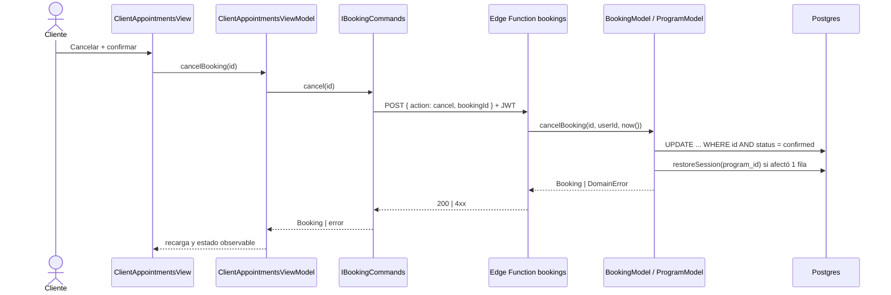

# Feature: Mis citas — cancelar cita del cliente

## Contexto

Hito 2 del PRD [`.claude/prds/mis-citas-cliente.prd.md`](../../.claude/prds/mis-citas-cliente.prd.md). El cliente ya ve sus citas ([`client-appointments.spec.md`](client-appointments.spec.md)); ahora puede **cancelar una cita futura** respetando una anticipación mínima y **recuperando la sesión de su programa**. Reprogramar es el hito 3.

Decisiones (plan [`mis-citas-cliente-cancelar-cita.plan.md`](../../.claude/plans/mis-citas-cliente-cancelar-cita.plan.md)):

- La regla de negocio se garantiza en el **backend** como **Supabase Edge Function**; no hay lógica en la BD (sin RPC ni triggers nuevos) ni en Next.js.
- La reserva guarda un instante **UTC** (`starts_at`) calculado **en el servidor** a partir de `date + time_slot` y la zona IANA del cliente enviada al reservar. Cancelar compara `starts_at` con el `now()` del servidor.
- Para eso, la **creación** de reservas también pasa por la Edge Function.
- Cancelar devuelve la sesión del programa que la reserva consumió (`program_id`).
- Sin notificación al entrenador (diferido).

**Issue**: TBD

## Roles Involucrados

- **Cliente**: autenticado con Google; cancela solo sus propias citas.
- **Sistema**: app nivel-ui + Edge Function `bookings`.

## Casos de Uso (Gherkin)

### Escenario 1: Cancelar con anticipación suficiente

```gherkin
Feature: Cancelar cita
  As a cliente autenticado
  I want cancelar una cita futura
  So that libero el cupo y recupero mi sesión sin coordinar con nadie

  Scenario: Cancela una cita de gym con más de 1 hora de anticipación
    Given el cliente tiene una cita de gym que empieza en 3 horas
    And la reserva consumió una sesión de su programa activo
    When cancela la cita y confirma
    Then la cita queda "Cancelada" y aparece en "Historial"
    And el programa recupera 1 sesión (usedSessions - 1)

  Scenario: Cancela una cita de gabinete con más de 24 horas de anticipación
    Given el cliente tiene una cita de gabinete que empieza en 30 horas
    When cancela la cita y confirma
    Then la cita queda "Cancelada"
```

### Escenario 2: Anticipación insuficiente

```gherkin
  Scenario: Gym con menos de 1 hora
    Given el cliente tiene una cita de gym que empieza en 30 minutos
    Then no ve el botón "Cancelar" y sí ve el motivo del plazo
    When el servidor recibe igualmente la petición de cancelar
    Then responde 409 con BookingCancellationNoticeError y la cita sigue confirmada

  Scenario: Gabinete con menos de 24 horas
    Given el cliente tiene una cita de gabinete que empieza en 23 horas
    Then no puede cancelarla y ve el motivo del plazo

  Scenario: Límite exacto
    Given una cita de gym que empieza exactamente en 60 minutos
    Then puede cancelarla
```

### Escenario 3: Casos rechazados

```gherkin
  Scenario: Cita ya cancelada o ya terminada
    Given la cita está cancelada o terminó
    When se intenta cancelar
    Then se rechaza con BookingValidationError y no cambia nada

  Scenario: Cita de otro cliente
    Given la cita pertenece a otro cliente
    When el cliente intenta cancelarla
    Then recibe 404 BookingNotFoundError (no se revela que existe)

  Scenario: Sin sesión iniciada
    When se llama a la función sin token válido
    Then responde 401

  Scenario: Doble clic
    Given el cliente confirma la cancelación dos veces seguidas
    Then el programa recupera una sola sesión
```

### Escenario 4: Devolución de sesión

```gherkin
  Scenario: Reserva sin programa activo al reservar
    Given la reserva no consumió ninguna sesión (program_id nulo)
    When se cancela
    Then se cancela sin devolver sesión y sin error

  Scenario: El programa ya expiró
    Given el programa de la reserva expiró
    When se cancela
    Then se cancela sin devolver sesión y sin error
```

### Escenario 5: Reservar calcula el instante en el servidor

```gherkin
  Scenario: Reserva con zona horaria del cliente
    Given el cliente está en la zona "America/Lima"
    When reserva el 2026-11-15 a las 09:00
    Then la reserva guarda starts_at = 2026-11-15T14:00:00Z y client_timezone = "America/Lima"
    And descuenta una sesión del programa activo y guarda su program_id

  Scenario: Zona horaria inválida
    When la petición trae una zona IANA inexistente
    Then responde 422 con InvalidTimeZoneError y no crea la reserva
```

## Contratos TypeScript

```typescript
// src/core/types/index.ts
export interface Booking {
  // ...existente
  startsAt: Date;                 // instante UTC, calculado en el servidor
  clientTimezone: string;         // IANA usada al reservar
  programId: string | null;       // programa del que se consumió la sesión
}

export const CANCELLATION_NOTICE_MINUTES: Record<ZoneType, number> = {
  gym: 60,
  gabinete: 24 * 60,
};

export type BookingCommand =
  | { action: 'create'; trainerId: string; date: string /* yyyy-MM-dd */; time: string /* HH:mm */; zone: ZoneType; timeZone: string }
  | { action: 'cancel'; bookingId: string };

// src/core/repositories/index.ts — interfaz pequeña (ISP); IBookingRepository no cambia
export interface IBookingCommands {
  create(command: Extract<BookingCommand, { action: 'create' }>): Promise<Booking>;
  cancel(bookingId: string): Promise<Booking>;
}

// src/core/models/BookingModel.ts
createBooking(input, now: Date, timeZone: string): Promise<Booking>;   // calcula startsAt
cancelBooking(bookingId: string, clientId: string, now: Date): Promise<Booking>;
canCancel(booking: Booking, now: Date): boolean;                        // puro

// src/core/models/ProgramModel.ts
restoreSession(programId: string): Promise<Program | null>;             // null si no procede

// src/core/types/errors.ts
export class BookingNotFoundError extends Error {}
export class BookingCancellationNoticeError extends Error {
  constructor(public zone: ZoneType, public minNoticeMinutes: number) { /* ... */ }
}
export class InvalidTimeZoneError extends Error {}
```

### Edge Function `bookings`

`POST /functions/v1/bookings` con `Authorization: Bearer <JWT del usuario>` (`verify_jwt = true`). Cuerpo: `BookingCommand`. El `clientId` sale del JWT, nunca del cuerpo. Escribe con el service role que inyecta el runtime.

| Estado | Causa |
|---|---|
| 200 `{ booking }` | Éxito |
| 401 | Sin sesión válida |
| 403 | Rol distinto de `client` |
| 404 `BookingNotFoundError` | Inexistente o de otro cliente |
| 409 `BookingCancellationNoticeError` / `BookingCapacityError` / cita ya cancelada | Regla de negocio |
| 422 `BookingValidationError` / `InvalidTimeZoneError` | Entrada inválida |

### Migración

```sql
ALTER TABLE public.bookings
  ADD COLUMN starts_at        TIMESTAMPTZ,
  ADD COLUMN client_timezone  TEXT,
  ADD COLUMN program_id       UUID REFERENCES public.programs(id) ON DELETE SET NULL;
-- backfill con la zona del servidor de BD (UTC, verificada):
UPDATE public.bookings SET starts_at = (date + time_slot::time) AT TIME ZONE 'UTC', client_timezone = 'UTC';
ALTER TABLE public.bookings ALTER COLUMN starts_at SET NOT NULL;
-- Después de desplegar la función: quitar "bookings: client insert" y "bookings: client cancel".
```

## Criterios de Aceptación

### Funcionales
- [ ] El cliente cancela una cita futura desde `/client/citas` con un diálogo de confirmación.
- [ ] Anticipación mínima: 1 h (gym) y 24 h (gabinete); el límite exacto se permite.
- [ ] El botón "Cancelar" no aparece en citas no cancelables y se explica el motivo.
- [ ] Cancelar devuelve una sesión del programa de la reserva, una sola vez, sin error si no procede.
- [ ] `starts_at` se guarda en UTC calculado por el servidor; cancelar usa el `now()` del servidor.
- [ ] Un cliente no puede reservar ni cancelar saltándose las reglas llamando a Supabase directamente (tras quitar las policies de escritura).
- [ ] No hay aviso al entrenador (fuera de alcance).

### No Funcionales
- [ ] Elementos con `data-testid`: `appointment-cancel-{id}`, `appointment-cancel-blocked-{id}`, `cancel-dialog`, `cancel-confirm`, `cancel-dismiss`, `cancel-error`.
- [ ] El reloj se inyecta en Model y ViewModel (sin reloj real en tests).
- [ ] Sin `any`; lógica de negocio solo en Models; errores de dominio en `errors.ts`.
- [ ] Modo local (sin Supabase): mismo contrato con `LocalBookingCommands`; la garantía de servidor solo aplica con backend real.

### Restricciones técnicas (spike, 2026-11-10)
- El Edge Runtime (Deno 2.1.4, CLI 3.1.0) monta el proyecto completo y **puede importar `src/core/...`**, pero **no resuelve imports sin extensión** (`'../types'`): hace falta `'../types/index.ts'`. Implica `allowImportingTsExtensions` en `tsconfig.json` (`noEmit` ya está activo) y reescribir los imports del código alcanzable desde la función.
- Las dependencias npm (`date-fns`, `@supabase/supabase-js`) se declaran en `supabase/functions/bookings/deno.json`; el flag `--import-map` y un `import_map.json` suelto no se aplicaron en el CLI 3.1.0.
- En el sandbox de desarrollo remoto el contenedor del runtime no confía en el CA del proxy y no puede bajar paquetes de npm: la prueba de punta a punta de la función se hace en una máquina con red directa; aquí se prueba el handler con Vitest.
- `supabase/config.toml` estaba desactualizado para el CLI 3.1.0 (`[inbucket]` → `[local_smtp]`, `major_version` 15 → 17, igual que producción).
- No verificado: que `supabase functions deploy` empaquete archivos de `src/` fuera de `supabase/functions/`. Se comprueba al primer despliegue.

### Tests Requeridos
- [ ] Unitario: `tests/unit/core/models/BookingModel.test.ts` (cancelar, plazos, límite, ajena, ya cancelada, zona horaria)
- [ ] Unitario: `tests/unit/core/models/ProgramModel.test.ts` (`restoreSession`)
- [ ] Unitario: handler de la Edge Function (códigos HTTP)
- [ ] Unitario: `tests/unit/core/view-models/ClientAppointmentsViewModel.test.ts`
- [ ] Unitario: `tests/unit/components/client/ClientAppointmentsView.test.tsx`
- [ ] Integración: `tests/integration/BookingFlow.integration.test.ts`
- [ ] E2E: `e2e/client-appointments.spec.ts` solo si hay modo autenticable

## Diagrama de Flujo



## ADRs Relacionados

- Pendiente evaluar un ADR: "Lógica de negocio de reservas en Supabase Edge Functions" (cambia el modelo de acceso a datos del cliente).

## Notas de Implementación

> Completar al implementar.
