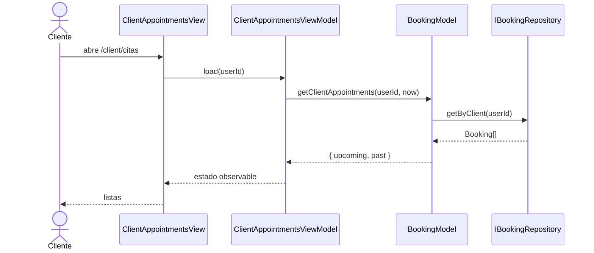

# Feature: Mis citas — vista de citas del cliente

## Contexto

Los clientes no pueden ver las citas que reservaron: hoy deben coordinar con el entrenador. El PRD [`.claude/prds/mis-citas-cliente.prd.md`](../../.claude/prds/mis-citas-cliente.prd.md) define tres hitos (ver, cancelar, reprogramar). Esta spec cubre solo el **hito 1: ver mis citas** (solo lectura). Cancelar y reprogramar tendrán su propia spec.

**Issue**: TBD

## Roles Involucrados

- **Cliente**: autenticado con Google; solo ve sus propias citas.
- **Sistema**: la aplicación nivel-ui.

## Casos de Uso (Gherkin)

### Escenario 1: Ver citas próximas

```gherkin
Feature: Mis citas
  As a cliente autenticado
  I want ver las citas que reservé
  So that no tengo que coordinar con el entrenador para consultarlas

  Scenario: El cliente ve sus citas próximas
    Given el cliente tiene dos reservas confirmadas que aún no terminaron
    When abre "Mis citas"
    Then ve ambas en "Próximas citas" ordenadas de la más cercana a la más lejana
    And cada cita muestra fecha, hora, entrenador, zona y estado "Confirmada"
```

### Escenario 2: Una cita deja de ser próxima al terminar

```gherkin
  Scenario: Una cita terminada pasa al historial
    Given el cliente tiene una cita a las 09:00 con duración de 60 minutos
    When son las 10:00 o más tarde del mismo día
    Then la cita aparece en "Historial" y no en "Próximas citas"

  Scenario: Una cita en curso sigue siendo próxima
    Given el cliente tiene una cita a las 09:00 con duración de 60 minutos
    When son las 09:30
    Then la cita sigue en "Próximas citas"
```

### Escenario 3: Historial con canceladas

```gherkin
  Scenario: El historial incluye citas canceladas
    Given el cliente tiene una cita pasada confirmada y una cita futura cancelada
    When abre "Mis citas"
    Then ambas aparecen en "Historial"
    And la cancelada muestra la etiqueta "Cancelada"
    And el historial va de la más reciente a la más antigua
```

### Escenario 4: Solo mis citas

```gherkin
  Scenario: El cliente no ve citas de otros clientes
    Given existen reservas de otros clientes
    When el cliente abre "Mis citas"
    Then solo ve las reservas cuyo clientId es el suyo
```

### Escenario 5: Estado vacío y error

```gherkin
  Scenario: El cliente no tiene citas
    When abre "Mis citas"
    Then ve el mensaje de que no tiene citas

  Scenario: Falla la carga
    Given el servicio de datos devuelve un error
    When abre "Mis citas"
    Then ve el mensaje de error y no ve listas
```

## Contratos TypeScript

```typescript
// src/core/types/index.ts
export interface ClientAppointments {
  upcoming: Booking[]; // no canceladas cuyo fin es posterior a "ahora"; orden ascendente
  past: Booking[];     // terminadas o canceladas; orden descendente
}

// src/core/repositories/index.ts
export interface IBookingRepository {
  // ...existente
  getByClient(clientId: string): Promise<Booking[]>;
}

// src/core/models/BookingModel.ts
getClientAppointments(clientId: string, now: Date): Promise<ClientAppointments>;
// Lanza BookingValidationError('El cliente es requerido') si clientId está vacío.
```

## Criterios de Aceptación

### Funcionales
- [ ] El cliente ve sus citas próximas e historial en `/client/citas`.
- [ ] Una cita pasa a historial cuando `fecha + hora + duración` es menor o igual a "ahora".
- [ ] Las citas canceladas van siempre al historial con etiqueta "Cancelada".
- [ ] Solo se listan reservas del cliente autenticado.
- [ ] `/client` tiene un enlace a "Mis citas".
- [ ] Estados de carga, vacío y error visibles.

### No Funcionales
- [ ] Elementos clave con `data-testid`: `link-my-appointments`, `appointments-loading`, `appointments-error`, `appointments-empty`, `appointments-upcoming`, `appointments-history`, `appointment-item-{id}`, `appointment-status-{id}`.
- [ ] La hora actual se inyecta (sin reloj real en Model ni en tests).
- [ ] "Próxima o pasada" se calcula con la hora local del navegador (limitación conocida; ver PRD, pregunta abierta de zona horaria).

### Tests Requeridos
- [ ] Unitario: `tests/unit/core/models/BookingModel.test.ts`
- [ ] Unitario: `tests/unit/core/view-models/ClientAppointmentsViewModel.test.ts`
- [ ] Unitario: `tests/unit/core/services/SupabaseDataService.test.ts` (`getByClient`)
- [ ] Unitario: `tests/unit/components/client/ClientAppointmentsView.test.tsx`
- [ ] Integración: `tests/integration/BookingFlow.integration.test.ts`

## Diagrama de Flujo



## ADRs Relacionados

- Ninguno.

## Notas de Implementación

- **Model**: `src/core/models/BookingModel.ts`
- **ViewModel**: `src/core/view-models/ClientAppointmentsViewModel.ts`
- **Componentes**: `src/components/client/ClientAppointmentsView.tsx`, `src/app/client/citas/page.tsx`
- **Tests**: ver "Tests Requeridos".
